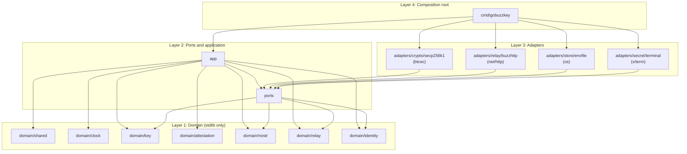
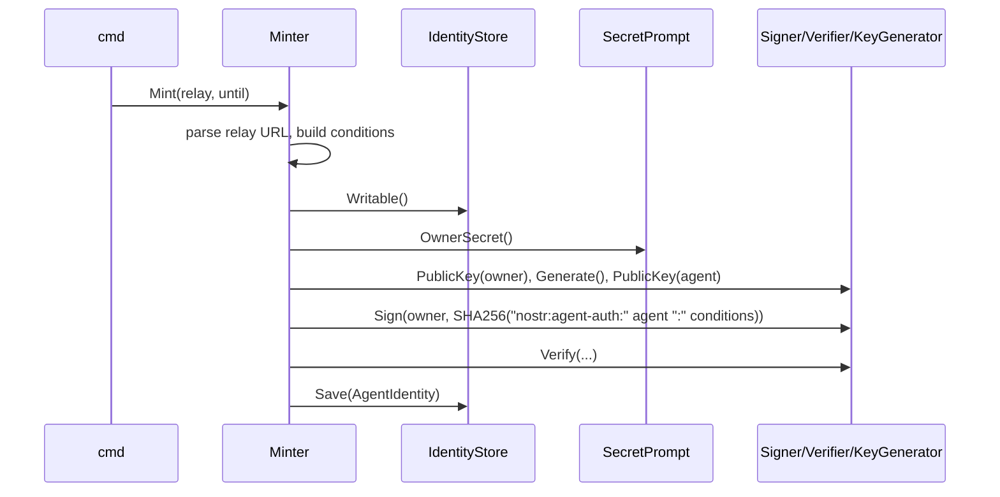

# gobuzzkey Architecture

## Contents

| Section | Topic |
|---|---|
| §1 | System overview |
| §2 | Layers and the Dependency Rule |
| §3 | Use cases and how they flow |
| §4 | Wire contracts (NIP-OA, NIP-98, Buzz REST) |
| §5 | Secret handling |
| §6 | Package layout |

Section numbers are stable; refer to them as `ARCHITECTURE.md §n`.

## 1. System overview

gobuzzkey does three things for an agent that should act on a Buzz relay under its own key:

- **mint**: generate the agent key, sign a NIP-OA owner attestation for it with the owner's key, and store the identity (`BUZZ_RELAY_URL`, `BUZZ_PRIVATE_KEY`, `BUZZ_AUTH_TAG`);
- **inspect**: check a stored identity or a bare attestation offline (key pairing, owner signature, expiry);
- **check**: sign in to the relay as the agent and prove it is admitted, can see its channels and, on request, can post.

The core (`domain/`, `ports/`, `app/`) has no external dependencies. Cryptography, HTTP, files and the terminal sit behind ports and live in adapters. `cmd/gobuzzkey` is the only place that reads the environment and wires the pieces together.

## 2. Layers and the Dependency Rule



### Dependency Rule

Source dependencies point inward only.

| Layer | May depend on | Never |
|---|---|---|
| 1. Domain | other domain packages, as listed in `.go-arch-lint.yml`; the standard library | ports, app, adapters, cmd, any third-party module, `os`, `net/http` |
| 2. Ports | domain | app, adapters, transport or library types |
| 2. App | domain, ports | adapters, cmd, `os`, `net/http` |
| 3. Adapters | domain, ports, their own library from `acl_*.go` | app, cmd, other adapters |
| 4. cmd | everything above | (nothing depends on cmd) |

Four checkers enforce this, so a violation has to defeat all of them:

1. `.go-arch-lint.yml` is the source of truth. Components map one-to-one to packages, `deepScan` follows method calls as well as imports, and a file outside every component fails the check.
2. `.golangci.yml` depguard repeats the inward rules per file and confines each library to its adapter's `acl_*.go` files.
3. `scripts/lint-domain-purity.sh` reads the compiled import graph of `domain/...` and fails on anything outside the standard library and `domain/`.
4. forbidigo rejects `time.Now` and friends outside `domain/clock/real.go`, environment access outside `cmd/gobuzzkey/main.go`, and direct printing anywhere.

### Why the domain does not sign

BIP-340 signing needs elliptic-curve scalar multiplication, which the standard library does not provide for secp256k1. Keeping the domain stdlib-only therefore puts signing, verification and key generation behind `ports.Signer`, `ports.Verifier` and `ports.KeyGenerator`. The domain still validates keys fully: an x-only public key is checked to lie on the curve with `math/big` (Euler's criterion), and a secret key to lie in `[1, n-1]`. See ADR-0002.

## 3. Use cases and how they flow

### Mint (`app.Minter`)



Every check that can fail without the owner's key runs before the owner's key is requested: relay URL, expiry, and whether the destination already exists.

The command `new` mints only when `-out` does not exist yet. Otherwise it opens the file and keeps it when `Inspector.Reusable` accepts it (same relay, attestation not expired), so a second run never asks for the owner's key. It then checks admission, with `-channel` joins and reads the channel, and last prints the Grok Bot prompt through the identity store (ADR-0004).

### Inspect (`app.Inspector`)

`Open` reads a stored record, derives the agent public key from the secret key and verifies the owner signature against that key. A tag issued for a different agent therefore fails as `SIGNATURE_INVALID`. `VerifyTag` does the same for a bare tag and a public key, with no secret. `Inspect` reports whether a relay would admit the attestation now.

### Check (`app.Checker`)

An expired attestation is rejected before any network call. The checker then queries kind-39000 channel metadata. A successful answer means the relay admitted the agent. A channel reference resolves by exact ID first, then by name; a name shared by several channels is refused with their IDs (`CHANNEL_AMBIGUOUS`), never guessed. It then reads the channel's recent kind-9 messages and, with `-send`, publishes a signed kind-9 message.

### Join and leave (`app.Checker`)

`Join` and `Leave` resolve the channel like `Check`, then read its kind-39002 member list. `Join` publishes a kind-9021 join request signed by the agent only when the agent is not listed; a private channel the agent is not in is `CHANNEL_NOT_VISIBLE` without any request, because Buzz lets only a member add someone to it. `Leave` publishes a kind-9022 leave request only when the agent is listed. Both refuse an expired attestation before the first relay call. The owner key is never used: it signs the attestation and nothing else.

## 4. Wire contracts

### NIP-OA attestation

```text
preimage = "nostr:agent-auth:" || agent-pubkey-hex || ":" || conditions
sig      = BIP-340(owner-secret, SHA256(preimage))
tag      = ["auth", owner-pubkey-hex, conditions, sig-hex]
```

`conditions` is empty or clauses joined by `&`: `kind=<n>`, `created_at<<t>`, `created_at><t>`, with canonical decimals and no whitespace. Clause order is part of the signature and is kept verbatim. gobuzzkey writes only `created_at<` (from `-expires`) and reads all three.

### Buzz admission (NIP-AA over REST)

Every request is `POST {relay}/query` or `POST {relay}/events` with:

- `Authorization: Nostr <base64(kind-27235 event)>`, signed by the agent, with tags `u` (absolute URL), `method`, `nonce` and `payload` (SHA-256 of the body);
- `x-auth-tag: <tag JSON>` when the identity is attested.

The relay URL is scheme, host and optional port only: Buzz checks the NIP-98 `u` tag against `scheme://<host>/<route>`, so a path prefix could never authenticate, and `relay.ParseURL` rejects it.

The relay admits the request when the agent is a member, or when NIP-OA admission is enabled (`BUZZ_ALLOW_NIP_OA_AUTH=true`), the tag verifies for the agent, its `created_at` clauses hold at the NIP-98 event's `created_at`, and the owner is a member. Kind clauses are not evaluated at admission. A refusal is HTTP 403 with `{"error":"relay_membership_required"}`, which `buzzhttp` classifies as `RELAY_MEMBERSHIP_REQUIRED`. `testutil/fakerelay` implements the same rules for tests.

### Event IDs

Event IDs use the NIP-01 canonical serialization, written by hand in `domain/nostr.Serialize` with the string escaping Buzz actually applies: rust-nostr hashes serde_json output, and nostr-tools hashes JSON.stringify output. Both escape `"` and `\`, use `\b \t \n \f \r`, write other characters below U+0020 as `\u00xx`, and leave everything else verbatim. `encoding/json` also escapes U+2028, U+2029 and `<>&`, which would change the ID of any message containing them. Message text must be valid UTF-8; `check` rejects anything else before signing.

An attested agent attaches its auth tag to every event the attestation covers, as buzz-cli does, so Buzz clients can show who authorized it.

## 5. Secret handling

| Secret | Where it exists | Where it may go |
|---|---|---|
| Owner key | `SecretPrompt` → `Minter.Mint` stack | one `Signer.Sign` call; never stored |
| Agent key | generated in `Minter.Mint`, held in `AgentIdentity` | `IdentityStore.Save` (identity file, or stdout with `-out -`, and the Grok Bot prompt); the signer, for NIP-98 and events |

`key.SecretKey` prints `nsec1…(redacted)` under every `fmt` verb and encodes to `{}` in JSON. It keeps its bytes inside a closure, because fmt cannot call `Format` on an unexported field: a struct holding a plain byte array, or even a pointer to one, would print the raw bytes under `%v` or `%s`. A func value is the one kind fmt only prints as an address. Only `adapters/store/envfile` (to serialize) and `adapters/crypto/secp256k1` (to sign) may call `Nsec` or `Bytes` (forbidigo). Output goes through injected writers, so a secret can only reach a terminal through code that deliberately prints it. Text from the relay or a file (channel names, error bodies, rejection messages) passes through `shared.Printable` before it is shown, so it cannot carry terminal escape sequences. Identity files are created with `O_EXCL` and mode 0600 and never overwritten.

## 6. Package layout

```text
domain/shared                 Error, Code (shared kernel)
domain/clock                  Clock, Real; clocktest.Fixed for tests
domain/key                    PublicKey, SecretKey, Signature, bech32 (NIP-19)
domain/attestation            Conditions, AuthTag, Attestation (NIP-OA)
domain/nostr                  Event, Unsigned, Filter, HTTPAuthTags (NIP-01, NIP-98)
domain/relay                  URL, Channel, WriteResult
domain/identity               AgentIdentity
ports                         Signer, Verifier, KeyGenerator, Relay,
                              IdentityStore, IdentitySource, SecretPrompt
app                           Minter, Inspector, Checker
adapters/crypto/secp256k1     BIP-340 via btcec
adapters/relay/buzzhttp       Buzz REST client with NIP-98 and x-auth-tag
adapters/store/envfile        env / JSON identity files
adapters/secret/terminal      hidden prompt, piped stdin, preset
cmd/gobuzzkey                 composition root: flags, env, output, exit status
testutil/fakerelay            in-process Buzz relay with real admission rules
tests/live                    env-gated test against a real relay
```
