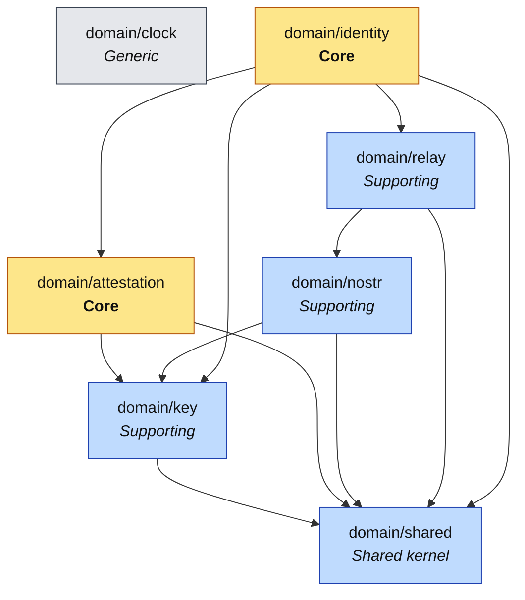

# gobuzzkey — Domain Model (DDD)

The domain layer (`domain/`, Clean Architecture Layer 1) is split into seven small bounded contexts. Each owns its types, invariants and terms. Cross-context imports are allow-listed in `.go-arch-lint.yml` and re-checked per file by depguard. All of them are stdlib-only (`scripts/lint-domain-purity.sh`).

For term definitions see [UBIQUITOUS.md](UBIQUITOUS.md).

## 1. Bounded contexts at a glance

| Context | Package | Subdomain | Purpose |
|---|---|---|---|
| Shared kernel | `domain/shared` | Supporting | `Error` and `Code`: the structured error every layer returns. |
| Clock | `domain/clock` | Generic | `Clock` and `Real`. All time is injected. |
| Keys | `domain/key` | Supporting | `PublicKey` (x-only, on-curve), `SecretKey` (redacting), `Signature`, NIP-19 bech32. |
| Attestation | `domain/attestation` | **Core** | NIP-OA: `Conditions`, `AuthTag`, the signing `Preimage`/`Message`, and the `Attestation` aggregate. |
| Nostr | `domain/nostr` | Supporting | NIP-01 `Event`, `Unsigned`, canonical `Serialize`, `Filter`; NIP-98 `HTTPAuthTags`. |
| Relay | `domain/relay` | Supporting | `URL` (normalized `http(s)` base), `Channel` (NIP-29 group metadata), `WriteResult`. |
| Identity | `domain/identity` | **Core** | The `AgentIdentity` aggregate: relay, agent secret, agent key and, usually, an attestation. |

## 2. Context map

An arrow means "imports". `domain/clock` imports nothing and is imported by `app` and the adapters, not by other domain contexts: the domain receives instants as values (`time.Time`, unix seconds) and never asks for the time.

## 3. Aggregates, entities and value objects

| Context | Type | Kind | Notes |
|---|---|---|---|
| attestation | `Attestation` | Aggregate root | Agent key + `AuthTag`. The unit of verification, because a signature is only meaningful against a specific agent. |
| attestation | `AuthTag` | Value object | `["auth", owner, conditions, sig]`. Structurally validated on decode. |
| attestation | `Conditions` | Value object | Validated grammar, kept verbatim (clause order is signed). |
| attestation | `Clause` | Value object | One `kind=` / `created_at<` / `created_at>` clause. |
| identity | `AgentIdentity` | Aggregate root | What gets minted, stored and checked. Attested or member. |
| key | `PublicKey`, `SecretKey`, `Signature` | Value objects | Comparable, immutable. |
| nostr | `Event`, `Unsigned`, `Filter` | Value objects | `Unsigned` fixes the ID before signing. |
| relay | `URL`, `Channel`, `WriteResult` | Value objects | |

Aggregate roots live in `*_aggregate.go` files, carry an `// aggregate-root` marker and expose `Validate() error`. Their fields are unexported; construction goes through `New…` functions that validate.

## 4. Who depends on the domain

| Consumer | Uses |
|---|---|
| `ports` | `identity`, `key`, `nostr`, `relay` types in interface signatures |
| `app` | every context; orchestrates them through ports |
| adapters | the contexts their port mentions, plus `attestation` for tag serialization |
| `cmd/gobuzzkey` | `shared` (exit status), `clock`, `key` |

## 5. Invariant summary

- An x-only public key is the x coordinate of a point on secp256k1. A secret key is in `[1, n-1]`.
- Wire hex (tag fields, event fields) is lowercase. User input may be any case, hex or bech32.
- A conditions string is empty or `clause(&clause)*`, with canonical decimals, `kind ≤ 65535`, `created_at ≤ 4294967295`, no whitespace. It is never reordered or normalized.
- An attestation's owner and agent differ (no self-attestation).
- An attested identity's attestation was issued for that identity's agent key. Whether the agent key belongs to the secret key needs curve arithmetic, so `app.Inspector.Open` checks it.
- A relay URL is `http` or `https`, has a host, and has no trailing slash, user info, query or fragment.
- An event ID is SHA-256 of the NIP-01 canonical serialization, with NIP-01 escaping only.
- At relay admission, only `created_at` clauses are evaluated, against the NIP-98 event's `created_at`. Kind clauses apply to events, not to admission.

## 6. Where to read more

- [NIP-OA](https://github.com/block/buzz/blob/main/docs/nips/NIP-OA.md), owner attestation, and [NIP-AA](https://github.com/block/buzz/blob/main/docs/nips/NIP-AA.md), agent admission, in the Buzz repository.
- [NIP-01](https://github.com/nostr-protocol/nips/blob/master/01.md), [NIP-19](https://github.com/nostr-protocol/nips/blob/master/19.md), [NIP-29](https://github.com/nostr-protocol/nips/blob/master/29.md), [NIP-98](https://github.com/nostr-protocol/nips/blob/master/98.md).
- `ARCHITECTURE.md §4` for how the contexts meet the wire.
